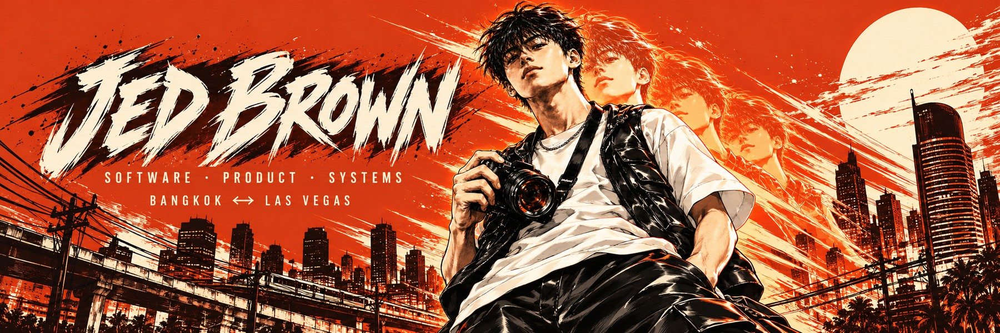
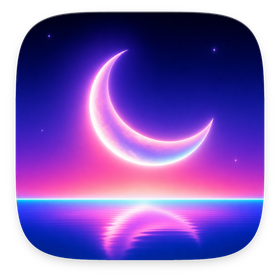
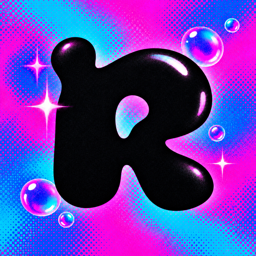

  

### Hi, I'm Jed.

I build Mac apps, local AI tools, and the software behind my own businesses. More coming soon. Most of it starts as something I needed myself. Based in Bangkok, roots in Las Vegas.

  <a href="https://jedbrown.vercel.app/"><b>Portfolio</b></a> &nbsp;·&nbsp;
  <a href="https://github.com/jedbrnth-eng/lucid-live-wallpaper"><b>Lucid (open source)</b></a> &nbsp;·&nbsp;
  <a href="https://github.com/jedbrnth-eng/sendit"><b>SendIt (game)</b></a> &nbsp;·&nbsp;
  <a href="https://github.com/jedbrnth-eng/rave-live"><b>RAVE LIVE (open source)</b></a> &nbsp;·&nbsp;
  <a href="https://jedhustles.com/"><b>Jed Hustles</b></a> &nbsp;·&nbsp;
  <a href="https://instagram.com/jedbrnlab"><b>Instagram (@jedbrnlab)</b></a>

---

### Selected work

My apps and games are open source under GPL-3.0. Use them, learn from them, and send improvements back to the project instead of copying it.

<table>
  <tr>
    <td width="150" valign="top"></td>
    <td valign="top">
      <b><a href="https://github.com/jedbrnth-eng/lucid-live-wallpaper">Lucid</a></b> &nbsp;<code>Swift</code> <code>SwiftUI</code> <code>macOS</code> &nbsp;open source · GPL-3.0 
      Live 4K wallpapers for every Mac display: 590+ space and nature loops, Apple Aerials and your own files, with a Home page of live previews, audio-reactive looks, Day &amp; Night and smart pausing. Native, no account, no tracking. Ships through GitHub Actions CI and checksummed releases with a one-line installer. 
      <a href="https://github.com/jedbrnth-eng/lucid-live-wallpaper#readme">Demo video</a> · <a href="https://lucid-wallpaper.vercel.app">Website</a> (Three.js / WebGL) · <a href="https://github.com/jedbrnth-eng/lucid-live-wallpaper/releases/latest">Latest release (1.3.0)</a>
    </td>
  </tr>
</table>

<table>
  <tr>
    <td width="150" valign="top"></td>
    <td valign="top">
      <b><a href="https://github.com/jedbrnth-eng/sendit">SendIt</a></b> &nbsp;<code>Godot 4</code> <code>GDScript</code> &nbsp;open source · GPL-3.0 · free 
      A night-highway traffic racer: thread the gaps at 200+ km/h, chain the combo, bank it before you wreck, and outrun the police. Free downloads for Mac, Windows and Linux, built and released through GitHub Actions CI. 
      <a href="https://github.com/jedbrnth-eng/sendit#readme">Gameplay video</a> · <a href="https://github.com/jedbrnth-eng/sendit/releases/latest">Latest release</a>
    </td>
  </tr>
</table>

<table>
  <tr>
    <td width="150" valign="top"></td>
    <td valign="top">
      <b><a href="https://github.com/jedbrnth-eng/rave-live">RAVE LIVE</a></b> &nbsp;<code>Swift</code> <code>Metal</code> <code>macOS</code> &nbsp;open source · GPL-3.0 
      A festival light show that plays along with whatever your Mac is playing: beat-locked stage lights, lasers, LED walls, pyro and 33 visualizers. Native Swift and Metal, no account, no tracking. Mac only for now, with a free DMG download and CI on every push. 
      <a href="https://github.com/jedbrnth-eng/rave-live#readme">Visuals reel</a> · <a href="https://github.com/jedbrnth-eng/rave-live/releases/latest">Latest release</a>
    </td>
  </tr>
</table>

### Stack

`Godot` · `Swift` · `SwiftUI` · `Metal` · `TypeScript` · `Next.js` · `Python` · `ffmpeg` · `Three.js / WebGL` · `GitHub Actions`

### Outside the editor

I run [Jed Hustles](https://jedhustles.com/), a wholesale sourcing business, and co-founded the festival wear brand [Groovin Angels](https://jedbrown.vercel.app/groovin-angels). That is where most of my software ideas come from: real problems, real customers.

---

  <a href="https://jedbrown.vercel.app/#contact"><b>Building something interesting? Let's talk ↗</b></a>

