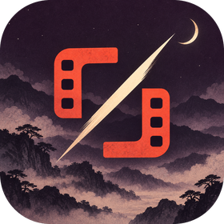
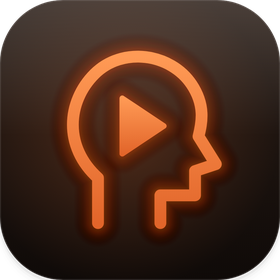

  

### Hi, I'm Jed.

I build Mac and iPhone apps, local AI tools, and the software behind my own businesses. Most of it starts as something I needed myself. Based in Bangkok, roots in Las Vegas.

  <a href="https://jedbrown.vercel.app/"><b>Portfolio</b></a> &nbsp;·&nbsp;
  <a href="https://github.com/jedbrnth-eng/lucid-live-wallpaper"><b>Lucid (open source)</b></a> &nbsp;·&nbsp;
  <a href="https://jedhustles.com/"><b>Jed Hustles</b></a> &nbsp;·&nbsp;
  <a href="https://instagram.com/jedbrnlab"><b>Instagram (@jedbrnlab)</b></a>

---

### Selected work

<table>
  <tr>
    <td width="150" valign="top"></td>
    <td valign="top">
      <b><a href="https://github.com/jedbrnth-eng/lucid-live-wallpaper">Lucid</a></b> &nbsp;<code>Swift</code> <code>SwiftUI</code> <code>macOS</code> &nbsp;open source · MIT 
      Live 4K wallpapers for every Mac display: about 590 space and nature loops plus Apple Aerials, from a native menu-bar app with no account and no tracking. Ships through GitHub Actions CI and versioned releases with a one-line installer. 
      <a href="https://lucid-wallpaper.vercel.app">Website</a> (<a href="https://github.com/jedbrnth-eng/lucid-site">source</a>, Three.js / WebGL) · <a href="https://github.com/jedbrnth-eng/lucid-live-wallpaper/releases/latest">Latest release</a>
    </td>
  </tr>
  <tr>
    <td width="150" valign="top"></td>
    <td valign="top">
      <b>BladeCut</b> &nbsp;<code>Python</code> <code>ffmpeg</code> <code>faster-whisper</code> <code>MCP</code> &nbsp;private 
      A local AI editor for short-form video. Silence cutting, word-timed captions, 9:16 reframing and caption styles run on a deterministic ffmpeg pipeline that never modifies the original file. An MCP server lets AI agents make the same edits. The cut logic is regression-tested against the original implementation on 3,000 random inputs.
    </td>
  </tr>
  <tr>
    <td width="150" valign="top"></td>
    <td valign="top">
      <b>Shelfcam</b> &nbsp;<code>Swift</code> <code>iOS</code> <code>Python</code> &nbsp;closed source · in TestFlight beta 
      An iPhone camera for film, disposable and digicam looks. Every look carries a label that shows which real equipment it is modelled on and how much evidence stands behind it, and a validator checks every label. In beta on TestFlight now, with an App Store release next. Want to try it before launch? <a href="https://jedbrown.vercel.app/#contact">Contact me for a TestFlight link</a>. <a href="https://jedbrnth-eng.github.io/framelab-site/">Support and privacy</a>.
    </td>
  </tr>
  <tr>
    <td width="150" valign="top"></td>
    <td valign="top">
      <b>No Brainrot</b> &nbsp;<code>TypeScript</code> <code>Next.js</code> <code>React</code> <code>Electron</code> &nbsp;private · in development 
      A calm Mac home for the videos, music and streams you follow. No Shorts, no thumbnails, no all-caps titles. Your subscribed channels are organized into boxes you set up yourself, like Podcasts or Tech, each showing the latest uploads from those channels.
    </td>
  </tr>
  <tr>
    <td width="150" valign="top"></td>
    <td valign="top">
      <b>GodIsGood</b> &nbsp;<code>Python</code> <code>ccxt</code> <code>Swift</code> &nbsp;private · paper trading only 
      A crypto trading bot that only paper-trades live market data until it passes a written risk gate. Risk limits are locked by a checksum, every position has a stop, there is no leverage, and backtests can support a strategy but never pass the gate on their own.
    </td>
  </tr>
</table>

### Stack

`Swift` · `SwiftUI` · `TypeScript` · `Next.js` · `Python` · `ffmpeg` · `Three.js / WebGL` · `GitHub Actions`

### Outside the editor

I run [Jed Hustles](https://jedhustles.com/), a wholesale sourcing business, and co-founded the festival wear brand [Groovin Angels](https://jedbrown.vercel.app/groovin-angels). That is where most of my software ideas come from: real problems, real customers.

---

  <a href="https://jedbrown.vercel.app/#contact"><b>Building something interesting? Let's talk ↗</b></a>

