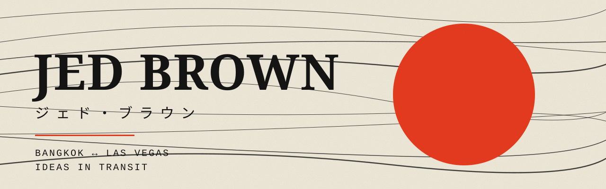
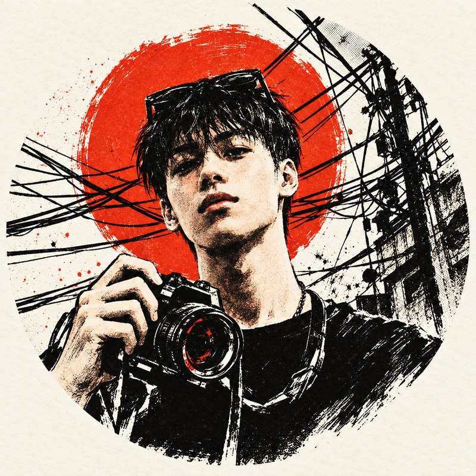

  

<table align="center">
<tr>
<td width="200" align="center"></td>
<td>

### Hey, I'm Jed.

Creative operator in **Bangkok**, roots in **Las Vegas**. I source products, build brands, and turn ideas into working businesses.

I like the whole journey: the brand, the site, the suppliers, and making the customer experience work in real life.

</td>
</tr>
</table>

  <a href="https://jedbrown.vercel.app/"><b>Portfolio</b></a> &nbsp;·&nbsp;
  <a href="https://jedhustles.com/"><b>Jed Hustles</b></a> &nbsp;·&nbsp;
  <a href="https://instagram.com/jedbrn"><b>Instagram</b></a>

---

### 作品 &nbsp;/&nbsp; Selected work

- **[Lucid](https://github.com/jedbrnth-eng/lucid-live-wallpaper)**: open-source macOS app. Free live 4K wallpapers for every display, written in Swift and SwiftUI, no dependencies.
- **[Jed Hustles](https://jedhustles.com/)**: my wholesale sourcing business, with a live catalog built around how customers actually browse and order.
- **[Ideas in Transit](https://jedbrown.vercel.app/)**: interactive portfolio, nine projects across web, commerce, brands and creative work.
- **[Groovin Angels](https://jedbrown.vercel.app/groovin-angels)**: festival wear brand I co-founded, spanning brand direction, suppliers and operations.

### 探求 &nbsp;/&nbsp; What I'm exploring

Thoughtful frontends, useful AI workflows, and the systems that help small teams turn a good concept into a real product. Recent web work in Next.js, TypeScript and CSS, plus native Mac apps in Swift.

---

  <a href="https://jedbrown.vercel.app/#contact"><b>Have something worth building? Let's talk ↗</b></a>

